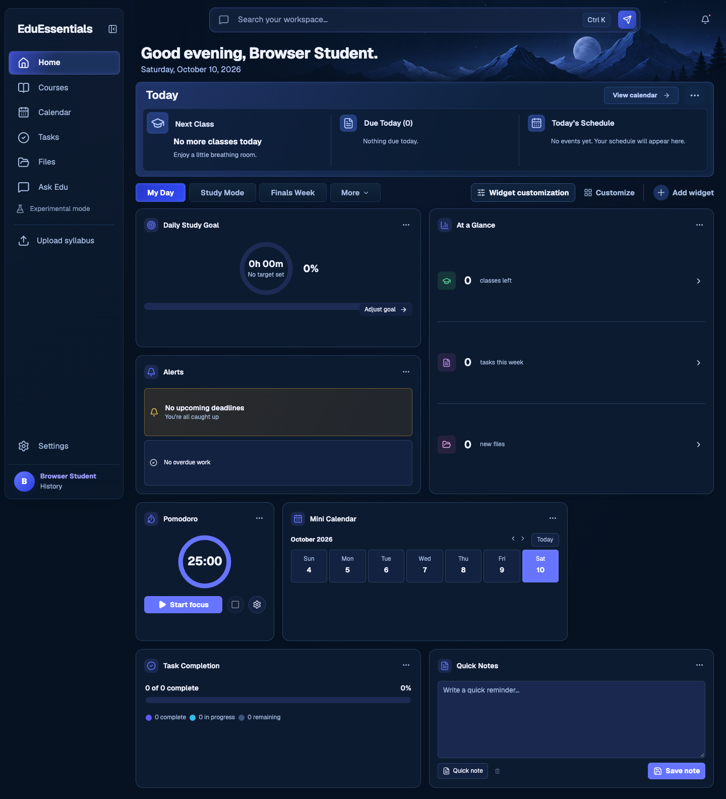
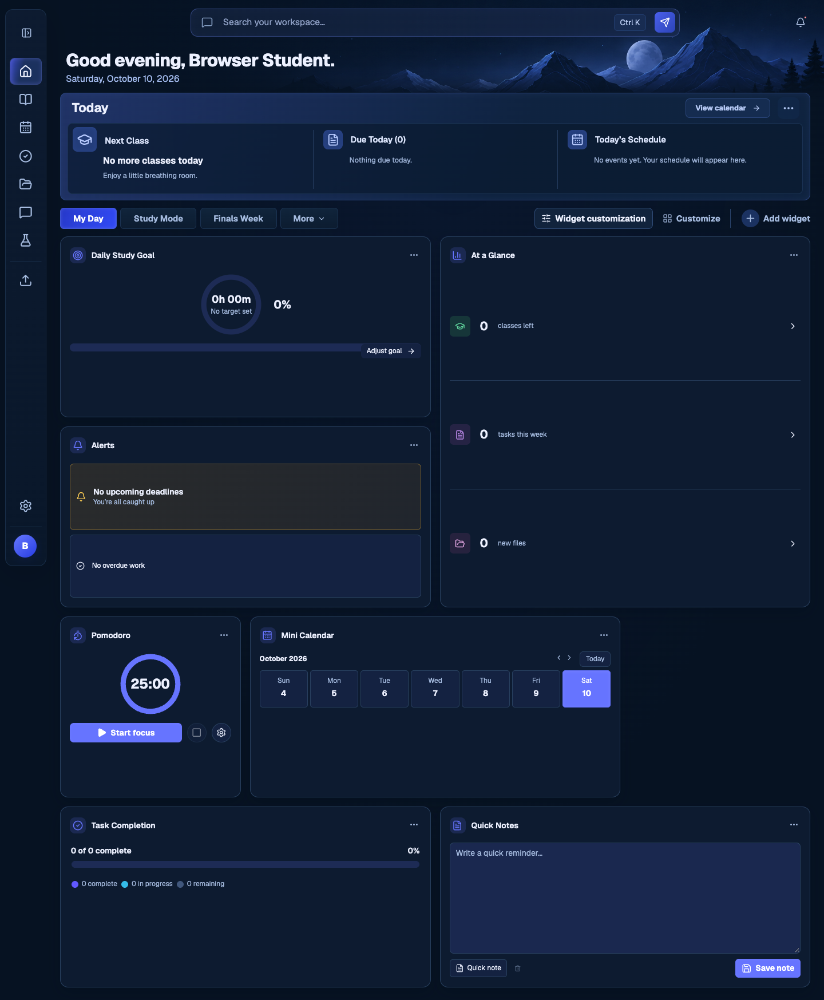
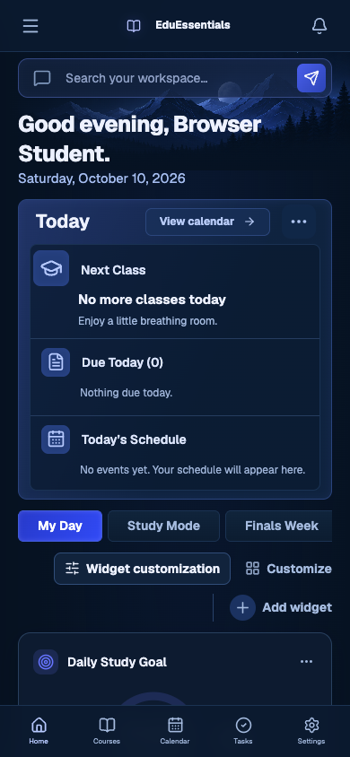
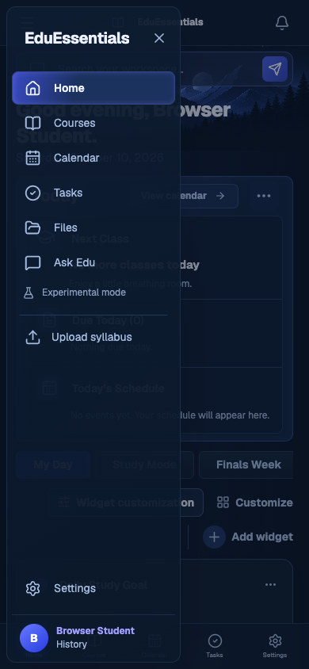

# EduEssentials design standard

**Reference:** Home and its shared sidebar · **Baseline captured:** October 10, 2026 (`9d43da9b`) · **Purpose:** guide future features and pages.

EduEssentials should feel like a calm, personal study workspace: deep navy surfaces, clear pale text, restrained indigo highlights, compact tools, and a persistent navigation frame. A new feature should feel at home beside the existing Home page before it introduces its own visual personality.

This document makes **Home and the sidebar the visual authority**. Other pages are outside the reference set. Their styling must not settle design decisions for new work.

## How to use this document

1. Start with the [principles](#1-design-principles) and [shell](#3-shared-shell-and-navigation).
2. Use the [tokens](#4-color-surfaces-and-depth), [typography](#5-typography-spacing-and-icons), and [patterns](#8-controls-menus-and-dialogs) when designing a feature.
3. Follow the [implementation recipes](#11-implementation-recipes) and [acceptance checklist](#12-design-acceptance-checklist) before shipping.
4. Use the [source map](#13-source-map-and-maintenance) to resolve implementation details.

**“Baseline” describes the current Home/sidebar implementation. “Standard” describes what future work must follow. “Recommendation” identifies a proposed improvement, not a change already made.** Screenshots support the written rules; they do not turn incidental limitations into requirements.

**Widget redesign:** the [widget design standard](widget-design.md) defines the
future shared widget frame, reference-based Small composition, per-size content,
and resize motion. Its widget targets supersede the recorded widget baseline for
new redesign work; the baseline values below still describe existing behavior.

## 1. Design principles

| Principle | What it means in a feature |
| --- | --- |
| Calm before decoration | Keep the canvas dark, borders subtle, shadows soft, and content legible. Let the mountain artwork remain a quiet header atmosphere. |
| Content leads | Put the task, deadline, progress, or note ahead of ornament. Use headings, alignment, spacing, and weight to organize information. |
| Familiar frame | Preserve the shared sidebar, global search, content gutters, mobile navigation, and profile location. |
| Indigo signals action or selection | Use bright indigo for the main action, the selected workspace, progress, and edit affordances. Keep ordinary controls quieter. |
| Compact, with breathing room | Match Home’s short toolbars and modest card padding. Increase space when reading, touch interaction, or form completion needs it. |
| Personalization stays local | Widget appearance changes belong to widgets and their related menus. They must not recolor the shared shell. |
| State is part of design | Loading, empty, active, disabled, saving, failed, editing, and completed states must fit the same visual language. |

**Keep these invariants:** the midnight canvas; Geist typography in the shell and page; thin cool-blue outlines; pale text with blue-gray supporting text; outlined Lucide icons; rounded rectangles; restrained gradients; navigation separated from content; consistent alignment during sidebar reflow.

## 2. Visual reference atlas

These images render the **actual Home and shell React components in a local browser fixture** with a fictional profile, empty academic data, the current default Home workspace definitions, default Midnight widget appearance, the bundled Geist font, and the real mountain asset. No authenticated production account was used. No other page was visited.

The fixture follows the project’s browser-verification approach: local CSS is assembled without the Tailwind import. Production screenshots should still be checked when accepting a future implementation. Text, dates, data, page height, and user-selected widget arrangements can differ from these examples.

### Desktop Home

1440 × 1000 viewport; full-page capture. Read the hierarchy from global search to greeting, Today, workspace controls, and the modular board.



### Collapsed sidebar

The rail keeps the same navigation order and active treatment while the content gains width. The profile reduces to its avatar.



### Mobile Home and navigation drawer

390 × 844 viewport captures. The header and bottom navigation remain fixed; search appears below the header. The drawer overlays the page.

| Home | Navigation open |
| --- | --- |
|  |  |

### Home interaction references

| State | Reference | What to preserve |
| --- | --- | --- |
| Customize and widget options | [View capture](design-reference/home-customize-menu.png) | Dashed edit outlines, resize corners, selected size, quiet unavailable actions, red removal action. |
| Loading | [View capture](design-reference/home-loading.png) | Persistent shell, reserved header space, Today silhouette, toolbar placeholders, cached card footprints. |
| Edit Today sections | [View capture](design-reference/home-today-editor.png) | Compact navy dialog, labeled choices, explanation, count, Cancel and Apply. |
| Add widget | [View capture](design-reference/home-widget-picker.png) | Searchable choices with icon, name, description, and clear close action. |
| Widget appearance studio | [View capture](design-reference/home-appearance-studio.png) | Preview beside settings, local draft controls, visible Cancel and Apply appearance. |

## 3. Shared shell and navigation

### Desktop composition

The sidebar floats inside the viewport; it is not a full-bleed edge-to-edge bar. It has a fine outline, rounded corners, a translucent navy gradient, and a soft shadow. The main canvas remains visible around it.

At desktop widths, the shell uses an outer `--ui-unit` of **1.125px at a 16px root font size**. The sidebar stays at this density while content can scale independently on wide screens. These are baseline values, not universal hard-coded pixel sizes:

| Property | Baseline CSS | Typical computed value |
| --- | --- | --- |
| Expanded sidebar width | `210 × --ui-unit` | 236.25px |
| Collapsed rail width | `64 × --ui-unit` | 72px |
| Left inset | `8 × --ui-unit` | 9px |
| Top / bottom inset | `14 / 10 × --ui-unit` | 15.75 / 11.25px |
| Sidebar radius | `12 × --ui-unit` | 13.5px |
| Sidebar padding | `16 / 6 / 0 × --ui-unit` | 18px top, 6.75px sides |
| Navigation row height | `42 × --ui-unit` | 47.25px |
| Navigation row radius | `8 × --ui-unit` | 9px |
| Navigation icon size | `21 × --ui-unit` | 23.625px |
| Global topbar height | `70 × --ui-unit` | 78.75px |

**Standard:** reuse the shell’s CSS variables and layout. A new page must not add a second sidebar, duplicate global search, replace the canvas, or invent its own desktop offset.

### Sidebar anatomy

The current order is:

1. **Brand:** EduEssentials wordmark and collapse/expand button. Desktop has no visible brand icon or tagline in this row.
2. **Primary links:** Home, Courses, Calendar, Tasks, Files, Ask Edu.
3. **Experimental mode:** quieter utility trigger below primary links, with a separate preview-data menu.
4. **Upload syllabus:** utility action below a thin horizontal divider.
5. **Bottom utilities:** Settings, then the profile strip with initial avatar, name, and major or “Student workspace.”

Primary links use left-aligned outlined icons and one-line labels. Home’s active link has a left-to-right indigo/navy gradient, a cool indigo outline, an inset glow, pale text, and weight 600. Hover uses a quieter raised navy surface. `aria-current="page"` identifies the destination.

The baseline hides navigation counts and the sidebar focus/streak card. Do not revive them merely because their markup or base CSS exists.

**Standard for new destinations:** use the existing `navItems` path, Lucide icon style, row geometry, active treatment, accessible label, and collapsed-rail behavior. Keep Settings and the profile at the bottom. Add a primary destination only when it warrants persistent navigation; local actions belong inside the page or an overflow menu.

### Collapse and reflow

Collapsed mode hides brand copy, navigation text, experimental text, and profile copy. The toggle, navigation icons, upload icon, settings icon, and avatar remain. Existing links provide `aria-label` and `title` so their meaning survives the hidden labels.

The preference uses `edu-sidebar-collapsed` in local storage and `data-sidebar-collapsed` on the root element before hydration. Preserve that early restoration to prevent a wide sidebar flashing before the rail appears.

Sidebar width, main-content offset, topbar dimensions, and backdrop position reflow together over **320ms** with `cubic-bezier(0.22, 1, 0.36, 1.06)`. Cards recalculate against the available width. Do not animate an independent page margin that falls out of sync.

At short desktop heights, the sidebar scrolls vertically so the bottom utilities remain reachable. Its content groups do not shrink into overlapping rows.

### Global search and notifications

Desktop search sits centrally in the topbar, with flexible space on either side and a notification button at the right. The search track has a maximum width of `760 × --ui-unit`, a height of `44 × --ui-unit`, and an `11 × --ui-unit` radius. It uses a faint blue gradient, outlined message icon, muted placeholder, shortcut badge, and indigo send button.

The actual shortcut handler supports **Ctrl+K and Cmd+K**; the baseline badge reads “Ctrl K.” The input is labeled “Search assignments, classes, and files.”

**Standard:** preserve search semantics, keyboard access, and a visible submit action. A feature-specific filter must have its own clear scope. The existing notification button produces status feedback; future notification features must make claims that match their actual behavior.

### Mobile shell

At **820px and below**, the desktop sidebar becomes an off-canvas drawer. At a 16px root size it is 220px wide, inset 8px from the left, top, and bottom. It opens from the mobile menu button and closes through the explicit X, the scrim, or selection of a navigation link. The desktop collapse control is hidden.

The fixed header is 58px high and contains menu, compact brand, and notifications. The global search remains below it. The fixed bottom navigation contains **Home, Courses, Calendar, Tasks, Settings**. Files and Ask Edu remain reachable through the drawer; the bottom bar does not include every sidebar destination.

The main area uses 20px side gutters and 80px bottom padding at the normal root size. Preserve safe-area padding on bottom navigation. Do not place a sticky feature control behind either fixed bar.

**Accessibility standard for new drawer work:** handle Escape, move focus into the open drawer, prevent focus entering the covered page, return focus on close, and prevent offscreen drawer controls receiving focus while closed. These are acceptance requirements; the current drawer markup is not proof that all are implemented.

## 4. Color, surfaces, and depth

### Shell palette

Use semantic roles rather than choosing a new hex color for each feature. These values come from `.reference-ui`, which overrides the light and generic dark tokens in `globals.css`.

| Token | Baseline | Role |
| --- | --- | --- |
| `--canvas` | `#061222` | Overall workspace background |
| `--surface` | `#0d1b30` | Main card/panel surface |
| `--surface-2` | `#11233c` | Raised or hover surface |
| `--surface-3` | `#192f54` | Stronger inset/accent surface |
| `--ink` | `#edf1ff` | Primary text |
| `--muted` | `#a5bbdf` | Supporting text |
| `--subtle` | `#7f98bd` | Low-priority text |
| `--border` | `#1b3352` | Quiet separators/outlines |
| `--border-strong` | `#304d79` | Raised controls and stronger boundaries |
| `--brand` | `#5969ff` | Shell accent and interaction |
| `--brand-dark` | `#b8caff` | Pale action/link text in the dark shell |
| `--brand-soft` | `#1b3261` | Low-intensity accent background |
| `--red` / `--red-soft` | `#ff8b96` / `#382335` | Destructive action or urgent failure |
| `--amber` / `--amber-soft` | `#ffce53` / `#302c25` | Attention or warning |
| `--green` / `--green-soft` | `#60daa2` / `#123a32` | Completion and positive progress |

`--brand-dark` is pale in this design. Use it by role, not by assuming its name means a darker swatch. The widget default accent is separately **`#6674ff`**; shell accent and widget accent are intentionally distinct.

### Surface hierarchy

| Layer | Baseline treatment |
| --- | --- |
| Canvas | `#061222` plus a subtle radial blue atmosphere near the top |
| Mountain header | Existing `mountain-header.png`, faded at the left and bottom into the canvas; decorative and noninteractive |
| Sidebar | `linear-gradient(150deg, #0e1c31ec, #0a182aec)`, border `#192e49` |
| Today outer panel | `linear-gradient(115deg, #293f80bb, #102543dd 60%)`, border `#2a447d` |
| Today inner area | `#09192eb3`, border `#1a3253`, thin blue dividers |
| Default widget | Solid `#0d1b30`, border `#28405f`, soft shadow |
| General popover | Navy `#10233c`, border `#304971`; widget-related menus use resolved appearance colors |
| Primary action | Indigo gradient outside widgets; resolved accent fill inside widgets |

**Standard:** use a strong visual layer for a summary or meaningful action, not every container. Thin outlines and a small surface shift should establish most boundaries. Reserve stronger glow for selected navigation, active workspace, or a deliberate focus state.

The mountain image belongs to the shared header atmosphere. It should remain behind text, stop before the body becomes visually busy, and have no accessible content of its own. Do not stretch it into a full-page feature background or introduce competing scenic art on a new page.

### Theme and contrast boundaries

The baseline Home/sidebar remains the `.reference-ui` midnight palette even when global theme preferences change. A global “light” preference does not establish a verified light Home design. Widget presets can independently produce light or colored cards.

**Standard:** preserve this baseline for new pages. A future light shell requires a coordinated design and verification of Home and sidebar together. Respect the existing motion and contrast preference plumbing; do not claim a complete high-contrast design merely because `data-contrast` is set. Test actual text, icons, borders, selection, and focus in the rendered state.

## 5. Typography, spacing, and icons

### Type hierarchy

The shell and Home use `var(--font-geist-sans), "Segoe UI", sans-serif`. Geist Mono is available but is not the general Home body typeface.

| Role | Baseline size | Weight / treatment |
| --- | --- | --- |
| Sidebar brand | `20 × shell --ui-unit` | Bold, tight tracking, 1.2 line height |
| Navigation | `14 × shell --ui-unit` | 400 normal; 600 active |
| Home page heading | `29 × page --ui-unit` | 750; 1.3 line height; `-0.6 × --ui-unit` tracking |
| Home supporting date | `15 × page --ui-unit` | Muted pale blue |
| Today panel title | `21 × page --ui-unit` | 650 |
| Today subsection heading | `14 × page --ui-unit` | 600 |
| Workspace tabs/actions | `14 × page --ui-unit` | Compact, restrained |
| Default widget heading | `14 × content density unit` | 600; 1.45 line height |
| Default widget body | `14 × content density unit` | 1.45 line height |
| Supporting widget text | Often `12 × widget --ui-unit` | Muted; final size depends on appearance |
| Metrics/timers | Commonly 20–24 × local unit | Semibold/bold; tabular numerals for timers |

At 1440px with normal root size, the Home heading is approximately **30.81px**, default widget titles are **14px**, and navigation text is **15.75px**. These differ because they belong to different sizing contexts.

**Standard:** one page-level heading; section headings below it; card headings below their owning section. Use sentence case for new page titles, labels, and actions. Existing Home widget title capitalization is a baseline detail, not a requirement to title-case every new label.

Use weight and spacing before uppercase. Compact uppercase labels are suitable for a small menu category or dialog eyebrow. Large blocks of tracked uppercase text do not fit the workspace’s reading style.

### Spacing and corner roles

Use the nearest established role rather than applying a single radius to every object:

| Role | Baseline |
| --- | --- |
| Small inline gaps | About 4–8 local units |
| Icon/text or related controls | About 7–12 local units |
| Page vertical rhythm | `--layout-gap`, normally `12 × page --ui-unit` |
| Default widget grid gap | `16 × content density unit` |
| Default widget padding | `16 × content density unit`, capped at 10% of card width |
| Default widget radius | `14 × content density unit` |
| Today panel radius | `10 × page --ui-unit` |
| Tabs / compact control radii | About 6–8 local units |
| Popover radius | About 12 density units |
| Standard modal radius | 20px desktop; compact dialogs can differ |
| Empty-workspace radius | Base `--radius-lg`, 24px |

Keep headings, rows, and footer actions aligned to their owning panel’s inset. Separate sibling content with spacing or a thin divider; avoid adding a nested card around every line.

### Iconography and data marks

Use **Lucide React** outlined icons. Sidebar primary icons use stroke width 2.1; other icons generally keep the library’s normal outlined style. Match optical size to the role rather than importing an unrelated icon family.

Default widget header icons sit inside a 28-density-unit tinted square with a radius of `0.65 × widget radius`; the glyph occupies 65% of that square. Today uses similar tinted blocks. Standalone toolbar icons have quiet blue-gray color; primary action icons inherit their action color.

Pair warning, completion, overdue, and course colors with words, symbols, or values. Course-color dots distinguish categories; they are not a substitute for status labels. Give charts legends or accessible summaries. Pair every progress ring/track with a readable value; keep timers stable with tabular numerals.

## 6. Home composition and responsive layout

### Home anatomy

Home is ordered as follows:

1. **Greeting and date.** Greeting follows the student’s local hour; the full date follows the configured time zone. Personalization is compact, with no oversized hero CTA.
2. **Today summary.** A single emphasized panel with header actions and a darker inner summary area.
3. **Workspace toolbar.** Workspace tabs on the left; appearance, Customize, and Add widget on the right when space permits.
4. **Widget board.** User-ordered modular tools; the document’s example arrangement is not a permanent page layout.

Today defaults to **Next Class, Due Today, Today’s Schedule**. Users can choose one to three distinct sections from those plus Study Goal, Upcoming Deadlines, and Study Streak. Today visibility and section selection belong to the active workspace.

Workspace tabs default to **My Day, Study Mode, Finals Week**, followed by the “More” add-workspace control. The selected tab uses a bright indigo gradient with white text; unselected tabs use dark gradients and thin borders. New feature filters should not imitate these tabs unless they actually switch views or workspaces.

Workspace controls deliberately have different emphasis: Widget customization is an outlined button; Customize is a quiet icon/text action; Add widget has a circular plus and a divider. The workspace overflow button appears in Customize mode. The trailing add-widget tile exists in the implementation but is hidden by the reference styling.

### Responsive rules

There are **viewport breakpoints and content-container breakpoints**. Do not replace one with the other.

| Condition | Baseline behavior |
| --- | --- |
| Viewport ≥ 821px | Floating sidebar or rail; desktop topbar; independently scaled page content |
| Viewport ≤ 820px | Mobile header/bottom nav; off-canvas sidebar; full-width main area with side gutters |
| `workspace` container ≤ 60rem | Today uses up to two columns; with three sections the third spans the next row; workspace toolbar stacks |
| `workspace` container ≤ 38rem | Today becomes one column with horizontal separators |
| Viewport ≤ 600px | Widget board changes from four columns to two |
| Viewport ≤ 520px | Search shortcut badge is hidden |

Container thresholds use rem, so they respond to the root font size. A sidebar toggle can change available content enough to trigger a new layout without changing viewport width.

At desktop widths above 1440px, the baseline derives spare space as `(100vw - 1440px) / 4` and content density as `max(0.0625rem, (100vw - spareSpace) / 1440)`. Main gutters use the existing shell formulas. Content expands and scales on wide screens; the sidebar does not grow with it. Reuse these variables rather than introducing a conflicting fixed maximum width or scaling the whole application with a transform.

**Measured anchors:** with a 16px root font, a 1440px viewport, and a reserved browser scrollbar gutter, expanded Home’s board begins around x=268.88px and is 1147.5px wide. Collapsing the sidebar moves it to x=104.62px and 1311.75px wide. At 390px the board is 350px wide, with 20px gutters. These validate the formulas; do not hard-code the measured coordinates.

**Standard:** page scrolling belongs to the main document. Allow local tab strips or necessary data regions to scroll intentionally. Avoid full-page horizontal overflow. Preserve `min-width: 0` and `minmax(0, 1fr)` where content must shrink. Long names should wrap or truncate deliberately without pushing actions offscreen.

## 7. Widgets and personalization

### Footprints

Widget size is a **grid footprint**, not a minimum-height request. Let `calculateWidgetPlacements` and `ReorderableWidgetGrid` own placement.

| Value | Visible label | Width × height in small-square units | CSS columns × half-rows |
| --- | --- | --- | --- |
| `mini` | Mini | 1 × ½ | 1 × 1 |
| `small` | Small | 1 × 1 | 1 × 2 |
| `medium` | Medium horizontal | 2 × 1 | 2 × 2 |
| `medium-vertical` | Medium vertical | 1 × 2 | 1 × 4 |
| `large` | Large | 2 × 2 | 2 × 4 |

For content width `W`, column count `C`, and resolved gap `G`, one small-square side is `(W - (C - 1)G) / C`. A half-row is `(squareSide - G) / 2`. Two half-rows plus their gap form one square. Adjacent minis can share a square; `startsNewMiniBlock` deliberately starts a new mini grouping.

Placement preserves user order and uses the project’s row-major packing logic. On phones, a two-column-wide card fills the board. Small and mini cards still occupy one column. Do not introduce CSS masonry, dense auto-placement, arbitrary pixel spans, or content-driven height growth into the widget board.

### Card anatomy

A widget is an `article.widget-card` containing a clipped `.widget-frame`, a header with icon/title/options, and a body. The options trigger must remain reachable; menus must escape inner clipping. During editing, the resize handle sits outside that clipped frame.

Default Midnight appearance is:

| Group | Defaults |
| --- | --- |
| Geometry | Gap 16, radius 14, padding 16, border width 1; lengths scale by content density |
| Color | Surface `#0d1b30`, accent `#6674ff`, border `#28405f`, text `#edf1ff`, muted `#a5bbdf` |
| Finish | 100% opacity; solid border; soft shadow; no blur, texture, gradient, or accent edge |
| Type | Body/title size 14, title weight 600, line height 1.45, zero tracking, left title alignment |
| Header | Filled icon treatment; icon size 28; icons visible; no header divider |
| Interaction | Lift hover; 180ms transition; content mode `expand` |

Card headings truncate to one line with an ellipsis inside the fixed footprint. When the widget container is 120px wide or less, the header icon is hidden and the options trigger is positioned at the top-right so it remains accessible.

The default soft shadow is `0 8D 24D rgba(3, 10, 22, 0.22)`, where `D` is the content density unit.

Despite the appearance model’s `expand` name and minimum-size fields, the current board enforces fixed footprints and clips the frame. Do not use those fields to enlarge a live card. The older gradient card rules in `reference-ui.css` are overridden by `widget-appearance.css`; the effective default card is solid navy with the resolved appearance above.

### Custom appearance contract

Resolve appearance with `resolveWidgetAppearance(state, widgetId)`, generate CSS with `widgetAppearanceStyle`, and retain the existing `data-wa-*` attributes. Defaults merge with per-widget overrides. Custom settings include palette, padding, radius, border, shadow, texture, typography, icon treatment, accent edge, hover, and motion.

A new widget’s text, inputs, controls, tracks, and menus must follow resolved colors. Test at least Midnight and Paper, plus a translucent or textured preset. Do not hard-code white text into a body that can have a light background. Conversely, do not expose the widget appearance variables to the entire shell.

**Standard for compact content:** prioritize one meaningful value and its primary action; reduce secondary detail as space tightens. Provide a route, dialog, or larger footprint for the full information. The current phone reference visibly clips some content and controls; this is a limitation to improve, not an acceptable pattern for a new essential action.

### Editing behavior

Customize mode adds a dashed outline and indigo corner resize affordance. The main control becomes “Done customizing.” Dragging shows a placeholder, lifted preview, and an intentional removal target in the Today region or a restored removal dock when Today is hidden.

Widget options include size choices, Move earlier/later, Duplicate, and Remove. Resize supports pointer interaction and arrow keys on the resize control; activating that control opens size choices. Move earlier/later provides a direct alternative to dragging. Double-tap or double-click can enter customization, but the visible Customize button remains the primary discoverable path.

Keep editing unavailable while conflicting dialogs or mutations are active. Disable impossible movement/duplication rather than silently doing nothing. Preserve confirmations that protect notes from destructive removal. Do not attach drag initiation to a child input, link, button, or text-editing region.

## 8. Controls, menus, and dialogs

### Controls and states

| Pattern | Use | Standard |
| --- | --- | --- |
| Primary button | Main next step: save, start, add, apply | Indigo fill/gradient; readable label; icon when useful; generally one primary action per decision area |
| Secondary button | Supporting action, cancel, view | Navy fill, fine outline, pale blue text |
| Quiet text/icon action | Compact tool or navigation within content | Clear accessible name; visible hover and focus; no unnecessary raised container |
| Destructive action | Remove/delete | Red text with explicit verb; separated from routine actions; confirmation when losing user content |
| Input | Search, note, form value | Dark inset surface, thin blue border, readable value, clear label and focus |
| Toggle/choice | State or mode | Visible selected state plus programmatic `aria-pressed`, `aria-selected`, or native input state |

Every new interactive control needs default, hover where appropriate, focus-visible, pressed/selected where relevant, disabled, and pending states. Disabled baseline controls use reduced opacity and a noninteractive cursor; explain an important dependency close to the control.

The base focus style is a 3px brand-colored translucent ring. The global search input deliberately suppresses its own ring. **Standard:** when an input suppresses its ring, provide a visible `:focus-within` treatment on the group. Never remove focus indication without replacing it.

### Menus

Use navy popovers with thin outlines, about 12-unit radii, compact padding, full-width rows, left icons, and clear selected states. Widget options are approximately 240 density units wide, clamped to viewport space. A menu can flip above its trigger or scroll internally; preserve a margin from viewport edges.

Close menus on Escape and outside interaction; restore focus when appropriate. Support keyboard navigation if using `role="menu"`; otherwise use ordinary buttons with a coherent focus sequence. Reposition during scroll, resize, and sidebar collapse. Do not clip a menu inside a widget frame or allow it to sit behind neighboring cards.

When portaling a menu, preserve the `.reference-ui` context and resolved appearance variables. Today’s menu already demonstrates this relationship. Menu colors should match the object being configured.

### Layering

Keep the existing stacking relationships instead of choosing a new arbitrary z-index. These values belong to the shell’s stacking context; child contexts can still constrain a menu.

| Layer | Baseline z-index |
| --- | --- |
| Mountain atmosphere | -1 |
| Desktop topbar | 30 |
| Fixed mobile header / bottom navigation | 50 |
| Mobile drawer scrim | 60 |
| Sidebar / open drawer | 70 |
| Hidden-Today removal dock | 80 |
| General popover | 90 |
| Drag preview | 120 |
| Standard modal backdrop | 200 |
| Toast stack | 400 |
| Skip link | 500 |
| Appearance studio backdrop | 1200 |

A widget with an open menu is raised relative to neighboring cards, but its inner frame stays clipped. Preserve the established portal or positioning strategy when a menu must escape a local stacking context. Do not solve an obscured menu by pushing an entire page above the sidebar or a modal.

### Dialogs opened from Home

| Dialog | Baseline form | Standard for future work |
| --- | --- | --- |
| Today editor | Compact navy panel, up to 520px wide, bordered choices, explanatory text, selection count, Cancel/Apply | Suitable reference for a short settings decision |
| Widget picker | Up to 900px wide, search, icon/name/description choices, count and Done footer | Suitable reference for a searchable tool catalog |
| Appearance studio | Large split preview/settings panel; presets and advanced controls; device previews; Undo/Redo; Cancel/Apply appearance | Keep this complexity for preview-driven customization |

Simple dialogs inherit the Home palette and have a darker scrim, a soft blur, a clear heading, an explicit close control, and a constrained scrollable body. Footer actions remain reachable at short heights and on phones.

The existing appearance studio has its own panel tokens and an Inter/system font stack. Treat that as a **specialized editor exception**, not permission to change the shell or general-page font. Its dialog is 18px rounded and uses a wider preview layout; it is not the baseline size for every form.

**Standard:** name each dialog, establish initial focus, trap focus, close on Escape when safe, return focus, and make the background inert. Draft edits are local until Apply; Cancel discards the draft. Keep the dialog open with a readable inline error when applying fails. Reuse the Today editor’s focus and draft handling where applicable; `aria-modal` alone does not implement those behaviors.

## 9. Loading, empty states, feedback, and copy

| State | Home baseline | Standard for new features |
| --- | --- | --- |
| Initial loading | Stable sidebar/topbar; hidden greeting text with reserved geometry; Today/toolbar/card silhouettes; subtle card sweep | Match the eventual layout and prevent placeholder controls being interactive |
| Reveal | Skeleton fades out over 160ms, then content fades in over 160ms | Avoid layout jumps; skip motion when reduced motion is enabled |
| Empty workspace | Dashed board, faint grid, icon, “Make this space yours,” short explanation, Browse widgets | Give a clear next step and an intentional quiet layout |
| Empty summary | Short local message such as “Nothing due today” | Distinguish empty from loading or failed; do not invent data |
| Saving | Quiet routine state with accessible announcement; transient status when needed | Keep user work visible; communicate actual persistence |
| Failed loading/saving | Error/status surface with explanation and applicable recovery actions | Preserve drafts; make recovery actionable; never show failure as an empty result |
| Success | Brief status feedback | Confirm the result without blocking the next action |

Home’s loading cache stores account-scoped layout geometry, widget order/size/grouping, Today visibility/section count, and gap. It is a silhouette, not a copy of notes or academic data. Preserve that boundary. Server data remains authoritative. The cache and live board must share placement rules.

Use both OS reduced-motion preference and the app’s `data-motion="reduced"` setting. Disable lift, sweep, shake, and decorative movement while preserving an immediate visible state change. A resize or cancellation during a loading transition must not leave invisible content inert forever.

**Copy standard:** use short concrete verbs: Add widget, Start focus, Save note, Edit section, Restore Today. Explain what happens next when it is not clear. Speak in the student’s vocabulary: class, task, deadline, study goal. Show “No target set” rather than an invented zero-percent accomplishment. Use complete supporting sentences where useful, and keep implementation details out of the product flow.

Local dates, times, week boundaries, and greeting must follow profile preferences consistently. Include labels or legends for progress and status. A warning color or decorative dot alone does not establish meaning.

## 10. Accessibility and baseline limitations

These requirements apply to new work without changing the visual reference:

- Use semantic links for destinations, buttons for actions, labeled inputs, meaningful headings, and landmarks. Preserve the skip link to `#main-content`.
- Keep names available when labels are hidden in the rail. Decorative glyphs and mountain artwork should not produce duplicate announcements.
- Maintain visible focus against dark, light-preset, selected, and hover surfaces. Meet contrast expectations for actual text and controls; opacity and gradients matter.
- Use at least a 24 × 24px target for new standalone controls, with adequate separation; aim for 44 × 44px for primary touch controls. Enlarge the hit area without enlarging every glyph.
- Provide keyboard equivalents for drag, resize, tab switching, and menu actions. For new tablists, include arrow-key navigation, a coherent tab stop, and associated panels.
- Keep dialogs and drawers usable at 200% zoom, enlarged text, and short viewport heights. Fixed navigation must not obscure focus or the final action.
- Announce material status changes through a status or alert region; avoid announcing every timer tick or animation frame.
- Do not claim that setting an ARIA attribute, theme preference, or contrast flag proves complete behavior.

**Known baseline limitations:** fixed widget frames can clip useful content on narrow phones; some compact icon targets are small; workspace tabs do not by themselves establish a complete keyboard tab pattern; global search lacks a strong group focus treatment; the drawer needs explicit focus management; theme/contrast flags do not establish a separately verified light or high-contrast Home shell. These are recommendations for future improvement, not changes made by this document or exemptions for new work.

## 11. Implementation recipes

### Add a page

1. State the page’s purpose and main student action. Decide which information is a summary, which is detail, and which belongs in an editor.
2. Add its route within the existing workspace layout and integrate it into the actual workspace rendering path. The current Home route returns `null`; its UI is rendered by `workspace-client.tsx`. Adding markup only to a route stub does not necessarily give it the same state or composition.
3. Reuse the `.app-shell.reference-ui` frame, global topbar, `.main-content`, and page sizing. Add a sidebar destination only when warranted; update route recognition and rendering together.
4. Match Home’s compact heading scale and muted supporting line. Give the page one main action, then its content panels.
5. Use ordinary content panels for reading, forms, or lists. Use widget classes only for actual modular Home widgets: those classes bring fixed footprints, clipping, appearance overrides, editing, and container behavior.
6. Define responsive behavior against the actual content container; preserve mobile shell gutters and bottom clearance.
7. Design loading, empty, disabled, error, and saved states before final review.
8. Complete the acceptance checklist and compare with Home at the same viewport and preferences.

**Suggested structure for future page content** (illustrative, not an existing component API):

```tsx
<div className="page feature-page">
  <header className="home-greeting">
    <h1>Page title</h1>
    <p>A short sentence describing this space.</p>
  </header>
  <div className="feature-toolbar">
    <button className="primary-button" type="button">Main action</button>
  </div>
  <section className="feature-panel" aria-labelledby="feature-title">
    <h2 id="feature-title">Section title</h2>
    {/* Student-facing content and its states. */}
  </section>
</div>
```

**Suggested local CSS** borrows the effective default Home card treatment while allowing ordinary page content to grow. Replace `feature-*` with a meaningful feature namespace; extract a shared panel primitive when more than one feature needs it.

```css
.reference-ui .feature-page {
  padding-top: calc(6 * var(--ui-unit));
}
.reference-ui .feature-toolbar {
  display: flex;
  flex-wrap: wrap;
  gap: var(--layout-gap);
  margin-bottom: var(--layout-gap);
}
.reference-ui .feature-panel {
  min-width: 0;
  padding: calc(16 * var(--desktop-density-unit, 1px));
  border: calc(1 * var(--desktop-density-unit, 1px)) solid #28405f;
  border-radius: calc(14 * var(--desktop-density-unit, 1px));
  background: var(--surface);
  color: var(--ink);
  font-size: calc(14 * var(--desktop-density-unit, 1px));
  line-height: 1.45;
  box-shadow: 0 calc(8 * var(--desktop-density-unit, 1px))
    calc(24 * var(--desktop-density-unit, 1px)) rgba(3, 10, 22, 0.22);
}
.reference-ui .feature-panel h2 {
  margin: 0 0 calc(14 * var(--desktop-density-unit, 1px));
  font: inherit;
  font-weight: 600;
}
```

This recipe intentionally has no widget footprint, clipping, drag behavior, or appearance settings. It is a proposal for new content, not a component added by this documentation change. Do not render another shell or main landmark inside it.

### Add a Home widget

1. Define the student benefit, data source, main value, main action, empty state, and reasonable default size.
2. Register its type and template through the existing widget model and picker. Follow current validation/persistence conventions; do not create an unrelated storage path.
3. Render through the existing widget card/header/body wrapper and resolved appearance. Avoid duplicating that wrapper inside the body.
4. Keep options, sizing, duplication, removal, keyboard resizing, and reorder alternatives working.
5. Design a compact summary for each supported footprint. Essential content must remain available even where a compact view cannot show everything.
6. Verify two- and four-column placement, mini grouping, sidebar reflow, both light/dark card presets, and reduced motion. Update skeleton behavior if introducing a new layout shape.

### CSS ownership and reuse

Read the effective cascade before borrowing a rule:

1. `globals.css` supplies resets, generic structure, control styles, mobile shell, and motion handling.
2. `reference-ui.css` supplies the Home/sidebar visual identity and shell/page density.
3. `widget-appearance.css` supplies effective card appearance and scoped palette behavior.
4. `widget-block-layout.css` supplies live footprints and clipping.
5. `widget-reorder.css` supplies editing/drag/resize affordances; `home-skeleton.css` supplies loading silhouettes and reveal layout.

Specialized Home dialogs have their own styles. A component’s effective appearance can come from inline `--wa-*` properties as well as CSS.

**Standard:** scope new styles to the feature under `.reference-ui`; prefer semantic shell tokens and existing sizing variables. Share a primitive when its behavior and appearance actually match. Do not fix one feature by adding a broad `.page`, `.sidebar`, `.widget-card`, `button`, or `h2` override that changes Home. Do not copy obsolete base card values or introduce a new font, radius system, icon pack, or parallel palette by accident.

## 12. Design acceptance checklist

A feature is ready when its design decisions and verification evidence satisfy the following. Unchecked items are work to resolve, not implicit approval.

### Visual consistency

- [ ] Home and sidebar were the comparison references; other pages did not supply visual defaults.
- [ ] Shared shell, mountain treatment, navigation order, profile position, and global search remain coherent.
- [ ] Colors, type hierarchy, borders, radii, spacing, shadows, icons, and action emphasis match the roles in this guide.
- [ ] Expanded and collapsed sidebar states keep content and controls aligned during and after reflow.
- [ ] Text, input values, charts, and controls work with resolved widget appearance where applicable.
- [ ] New selectors do not unintentionally alter Home or the sidebar.

### Layout and content

- [ ] Compare desktop at 1280, 1440, and 1920px; check the 820/821px drawer boundary.
- [ ] Compare phone at 320 and 390px; check the 600/601px widget-column boundary where applicable.
- [ ] Check both sides of the 38rem and 60rem content-container thresholds, including a sidebar toggle that crosses one.
- [ ] Check short viewport height, 200% zoom, enlarged text, long names, long notes, missing metadata, zero values, and dense data.
- [ ] No accidental document-level horizontal overflow, overlapping actions, clipped essential controls, or hidden footer behind mobile navigation.
- [ ] For widgets, each supported footprint and mini grouping respects placement and user order.

### Behavior and accessibility

- [ ] Loading, populated, empty, selected, editing, disabled, saving, failed, and completed states are deliberate where applicable.
- [ ] Focus is visible; input groups and icon-only controls have usable names and targets.
- [ ] Keyboard users can complete the workflow, including menu dismissal, tab switching, resize/reorder alternatives, and dialog/drawer exit.
- [ ] Focus enters and returns from overlays correctly; inactive background/hidden controls cannot receive focus.
- [ ] Status and urgency have text or symbols as well as color; progress has labels and values.
- [ ] Reduced motion works through OS and app preferences. Presets/contrast/zoom are assessed in the rendered UI.
- [ ] User edits survive failed saves and interrupted transitions; Cancel/Apply behavior matches the copy.

### Evidence and maintenance

- [ ] Capture representative desktop, collapsed-sidebar, mobile, and affected interaction states using fictional data.
- [ ] Review the actual production CSS/font composition in addition to local fixtures when releasing.
- [ ] Run relevant existing behavioral checks when implementation changes layout or interactions; avoid treating a screenshot as proof of keyboard or persistence behavior.
- [ ] Explain any intentional design extension and update this guide if it changes the shared standard.

## 13. Source map and maintenance

These are the Home/sidebar sources used for this standard. Shared files contain other routes; the reference is limited to the Home and shell paths and their effective rules.

| Concern | Source |
| --- | --- |
| App frame, sidebar, search, mobile nav, Home, widget wrapper/options/picker | [workspace-client.tsx](../app/workspace-client.tsx): `navItems`, `defaultWorkspaces`, shell JSX, `renderHome`, `renderWidget`, `renderWidgetBody`, `renderWidgetPicker` |
| Workspace route frame and Home route | [Workspace layout](../app/(workspace)/layout.tsx), [Home route](../app/(workspace)/home/page.tsx) |
| Reference palette, navigation, Today, shell density, responsive reflow | [reference-ui.css](../app/reference-ui.css): `.reference-ui` and Home/sidebar rules |
| Base controls, generic modal/menu, empty workspace, mobile shell, focus/motion | [globals.css](../app/globals.css): shared rules used by Home/sidebar |
| Geist setup and pre-hydration sidebar restoration | [Root layout](../app/layout.tsx), [sidebar-preference.ts](../lib/sidebar-preference.ts) |
| Today menu/editor and section model | [today-section.tsx](../app/today-section.tsx), [today-sections.ts](../lib/today-sections.ts) |
| Effective appearance, defaults, presets, CSS generation | [widget-appearance.ts](../lib/widget-appearance.ts), [widget-appearance.css](../app/widget-appearance.css) |
| Appearance studio | [widget-customization.tsx](../app/widget-customization.tsx), [widget-customization.css](../app/widget-customization.css) |
| Footprints and placement | [widget-layout.ts](../lib/widget-layout.ts), [widget-block-layout.css](../app/widget-block-layout.css) |
| Reorder/resize behavior and editing visuals | [reorderable-widget-grid.tsx](../app/reorderable-widget-grid.tsx), [widget-reorder.css](../app/widget-reorder.css), [use-widget-resize.ts](../app/use-widget-resize.ts), [widget-resize.ts](../lib/widget-resize.ts) |
| Loading silhouette, cached geometry, reveal | [home-skeleton.tsx](../app/home-skeleton.tsx), [home-skeleton.css](../app/home-skeleton.css), [home-load-transition.tsx](../app/home-load-transition.tsx), [home-skeleton.ts](../lib/home-skeleton.ts) |
| Preferences and save feedback | [use-preferences.ts](../app/use-preferences.ts), [save-toast.tsx](../app/save-toast.tsx) |
| Header artwork | [mountain-header.png](../public/mountain-header.png) |

**Verification for this baseline:** Home-only browser captures inspected expanded/collapsed sidebar, mobile Home/drawer, Customize/options, Today editor, widget picker, appearance studio, and loading. Width checks at 320, 390, 600, 601, 820, 821, 1280, 1440, and 1920px found no document horizontal overflow in this fictional default layout. The capture run reported no browser JavaScript errors. This is layout evidence, not a full accessibility or production release audit.

When the shared Home/sidebar design intentionally changes, update the written rules, token tables, measured anchors, and affected reference images together. Use fictional data. Record the reference date and scope. A one-off page exception must not silently become the application standard.
