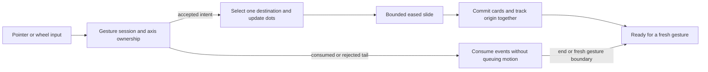

# Priority carousel: swipe research and rebuild

Researched on 2026-10-21. Scope: the dashboard's **Your priorities** assignment pages, including touch, mouse dragging, and horizontal trackpad input.

## Examples and evidence

These projects have public implementations, interactive examples, documented APIs, and substantial community interest. GitHub stars are a rough popularity signal, not proof of usability or a formal user-satisfaction rating. Counts below are rounded snapshots from the linked repositories.

| Implementation | Popularity evidence | Relevant behavior | Application here |
| --- | --- | --- | --- |
| [Swiper](https://github.com/nolimits4web/swiper) | About 41.9k stars | Its [API](https://swiperjs.com/swiper-api) exposes transition interaction locking, axis-specific wheel handling, click prevention, and resistance controls. | Accept one destination, lock that transition, and suppress clicks generated by dragging. |
| [Embla Carousel](https://github.com/davidjerleke/embla-carousel) | About 8.5k stars | Stable v8 has distinct [selection and settling events](https://www.embla-carousel.com/docs/v8/api/events), with [snap and drag options](https://www.embla-carousel.com/docs/v8/api/options). | Update dots when a destination is selected; commit the visible assignment page at arrival. Keep one adjacent snap and hard boundaries. |
| [Keen Slider](https://github.com/rcbyr/keen-slider) | About 5k stars | Its [documentation](https://keen-slider.io/docs) separates slide changes from animation completion and exposes animation duration/easing and rubber-band behavior. | Model selection, dragging, and settling explicitly; keep timing and easing independently testable. |

The comparisons concern documented behavior and source inspection. They do not represent a physical-device usability study.

## Trackpad findings

One physical swipe produces many wheel events, including inertia after fingers leave the trackpad. Finishing an animation is therefore not a reliable signal that another physical gesture started.

Swiper's [versioned mousewheel implementation](https://github.com/nolimits4web/swiper/blob/v12.0.3/src/modules/mousewheel/mousewheel.mjs) keeps recent event magnitudes, directions, and times. Its snapped mode checks renewed input rather than blindly advancing for every packet. This is the basis for our event-history approach; the exact thresholds and controller below are application-specific, not copied Swiper code.

[wheel-gestures](https://wheel-gestures.xiel.dev/docs/) provides a dedicated normalization and momentum-analysis layer, also used by an [Embla wheel plugin](https://github.com/xiel/embla-carousel-wheel-gestures). The source distributed in its [2.3.0 npm release](https://www.npmjs.com/package/wheel-gestures/v/2.3.0) analyzes acceleration and detects renewed input during momentum, with adaptive gesture-end timing. Its active-input end debounce has a 100ms floor, which does not directly fit the requested 70ms repeat target. The published source archive was downloaded and inspected during this research; older 2.2.48 lacks the newer native-momentum branch.

The [WheelEvent interface](https://developer.mozilla.org/en-US/docs/Web/API/WheelEvent) supplies deltas and units. The [Pointer Events Level 4 Working Draft](https://www.w3.org/TR/pointerevents/#interface-wheelevent) now specifies `momentum`, and [Chrome 151 introduced it](https://developer.chrome.com/release-notes/151#_wheel_event_momentum) to identify native inertial input. This is not evidence of universal browser support. Feature-detect the boolean, use it when supplied, and retain event-history handling when absent. Without a portable physical gesture phase, fallback classification necessarily remains heuristic.

## Design decision

Replace the component's interdependent animation, burst, axis, and cooldown refs with a testable controller. React becomes the rendering and browser-event adapter. Adopt the lifecycle and event-history patterns above while retaining the requested 70ms target and rigid, bounded movement.

The 70ms target comes from the product request, not a timing recommendation from these libraries. Gesture thresholds are our implementation choices and must be assessed through event-stream tests and device use.

A generic carousel dependency would still require custom wheel-session ownership and transition rules for these requirements. Embla's duration also represents physics tuning rather than a literal millisecond duration. A small controller lets us test the required timing and rejected-gesture behavior directly, without adding a second motion engine.

### State and ownership

- Page state has explicit `idle`, `dragging`, and `settling` phases. One selected destination drives the dots immediately; the committed page drives rendered assignments until arrival.
- Wheel sessions distinguish tracking, consumption, and rejection. A session survives animation completion. An ignored second gesture cannot resume midway through merely because the first slide arrived.
- Event history filters decaying momentum. A confirmed renewed impulse can begin a fresh consumed session; a rejected session requires an end or quiet boundary and cannot use an impulse to bypass its rejection.
- Pointer identity owns the entire drag from down through up/cancel. A pointer that begins during settling stays ignored until release.
- Animation uses one frame token and a fixed deadline. Extra input cannot retarget, restart, queue, or extend it. Page, origin, and indicator commit together.
- Horizontal movement owns horizontal input; vertical-first gestures retain native scrolling. Ctrl+wheel zoom remains native.

### Product constraints retained

Two assignments per page; one adjacent page per accepted gesture; hard first/last boundaries; no spring, bounce, overshoot, or velocity projection; a capped preview; eased settling targeting 70ms; immediate dots; reduced-motion support; and lifecycle cancellation on resize, blur, hidden documents, preference changes, assignment-order changes, and unmount.

The existing previous/next buttons, polite page status, and inert offscreen previews remain. These follow the [WAI-ARIA carousel pattern](https://www.w3.org/WAI/ARIA/apg/patterns/carousel/) guidance on named controls and hiding unavailable content from assistive technology.

## Verification approach

Test event streams rather than relying only on timer constants: rapid deliberate swipes, long decaying tails without a native momentum flag, new impulses during tails, rejected gestures crossing arrival, reversals, vertical-first mixed input, pointer cancellation, and recovery after spam. Run the same behaviors through the React adapter and Chrome, with real CDP touch input for native vertical panning. Synthetic wheel events cannot certify every physical trackpad's cadence.

See [the implementation behavior notes](priority-swipe-motion.md) for the final controller contract and validation commands.

## Rebuild validation

- **68 focused tests passed**, covering controller event streams, the React adapter, Strict Mode replay, pointer ID reuse after a missed release, accessibility, lifecycle cleanup, and bounded motion.
- **Chrome 155 checks passed** with no page or console errors. The measured destination-dot latency was 5.7ms, and a 70ms target slide committed in 72.7ms in that run. The fallback decay/renewed-impulse check and native CDP touch panning both passed. These are measurements from the fixture, not guarantees for every frame rate or device.
- **Five historical recorded streams were replayed** from the MIT-licensed `wheel-gestures@2.3.0` npm archive, without adding the package as a dependency or copying its fixtures into this repository. `swipe-right.json`, `swipe-right-fast.json`, `swipe-left-trackpad.json`, and `swipe-left-fast-trackpad.json` each advanced one page; `double-swipe-right.json` advanced two. The double stream exposed an initial missed repeat, fixed by retaining an established decay trend through small fluctuations before a renewed impulse.
- TypeScript, scoped ESLint, whitespace checks, and the production build passed.

The archive was obtained with `npm pack wheel-gestures@2.3.0 --ignore-scripts`; the replay normalized horizontal direction and preserved recorded packet timing while advancing a simulated 60Hz frame clock. Historical recordings broaden regression coverage but do not replace testing the current app on a physical trackpad.
