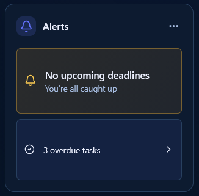

# Widget design standard

**Date:** October 17, 2026 · **Scope:** every Home widget, every supported size, and appearance previews.

**Status:** design specification for future implementation. The reference layouts and motion direction come from the user; the normalized token values and motion timings below are proposed implementation targets. This document does not change runtime behavior.

Every widget should feel built from the same frame. Keep its icon badge, title, typography, outer padding, and alignment consistent. Use additional space for useful content. During resize, existing content should move smoothly, new details should fade in, disappearing details should fade out, and charts should resize gently. These changes must happen during the gesture, not only after release.

## 1. Visual authority

### Shared headers by column span

The following user-supplied images are the primary header references. Select the reference by the widget's rendered column span, rather than by its type or height.

#### Two-column widgets

Use this header composition for **Medium horizontal (`medium`) and Large (`large`)** widgets. The title remains beside the badge on the left, while the options button stays at the trailing content edge. Additional width becomes flexible space between the title and options.

#### One-column widgets

Use this header composition for **Mini (`mini`), Small (`small`), and Medium vertical (`medium-vertical`)** widgets. Preserve the same badge, glyph, title typography, inset, and options geometry as the two-column header; only the available horizontal space changes.

Both references use the same shared treatment: outlined icon in a tinted rounded square, semibold title, and quiet trailing options button. Keep their dimensions and alignment identical across widget types and sizes. The icon symbol and title identify the widget; they do not establish a different header style. The shared sentence-case title rule in the token table still applies; the images establish composition rather than a capitalization exception.

Build both compositions from the same responsive header component using the tokens below. These images are design references, not raster assets to render as the actual header. During a one-column ↔ two-column resize, keep the header mounted and let its flexible title region change width smoothly; do not swap or scale the entire header. If a viewport fallback changes the rendered span, use the reference for that resolved span.

The [original Upcoming assignments header](design-reference/widget-header-reference.png) remains a supporting reference for the shared visual treatment.

### Small widget composition

This is the Small layout reference. Preserve its comfortable outer inset, clear header/body separation, substantial content panels, narrow gap between panels, and balanced bottom space. Both panels use the available body rather than leaving a small cluster at the top of a mostly empty card.

The reference approves composition, not the data or wording. In particular, “No upcoming deadlines” and “3 overdue tasks” need precise scope and truthful copy. Do not copy the apparent status ambiguity into the implementation. Other widgets should match the composition's balance without acquiring alert colors, unnecessary nested panels, or fabricated content.

The [Home and sidebar standard](design-system.md) continues to own the shell, palette, and navigation. This document owns the target widget frame, content layout, and resize behavior. Where its targets differ from that document's recorded widget baseline, use these targets for the future widget redesign; the older baseline still describes existing code.

## 2. Shared frame and tokens

Use one frame: **card → header → body → optional footer inside body**. Each widget implements body content; the shared frame owns padding, heading, icon badge, options, and edit affordances. Never add a second outer inset inside a body component.

The following values are normalized design targets at **1× workspace density**, derived from the references rather than claimed as exact screenshot measurements. Apply one shared density factor to the whole board. Browser zoom and an explicit accessibility text setting must still work. A widget's footprint must never select a different header font or padding scale.

| Token / role | Target at 1× | Rule |
| --- | --- | --- |
| Card inset | 20px on all sides | Same in every widget and size; measured inside the border |
| Card radius / border | 16px / 1px | Same shape throughout the board |
| Header visual height | 32px | Icon, title, and options centered on one horizontal axis |
| Header badge | 32 × 32px; 10px radius | Fixed square; cannot shrink or become circular |
| Badge glyph | 20 × 20px; Lucide outline, stroke 2 | Same optical size and centered placement |
| Badge surface | Resolved accent at 16% over card surface | Always retain the tinted background |
| Icon → title / title → options gap | 12px minimum | Title consumes remaining width |
| Title | Geist Sans, 16px / 22px, weight 600, tracking 0 | Sentence case, left aligned, one line |
| Options | 16px glyph in 32 × 32px visual slot | Trailing edge aligns with body content edge |
| Header → body | 20px | No widget-specific negative margins |
| Body text | Geist Sans, 14px / 20px, weight 400 | Strong labels use weight 600 |
| Supporting text | Geist Sans, 12px / 18px | Use resolved muted color |
| Primary metric | 28px / 34px, weight 600 | 36px / 42px only for a deliberate expanded metric role |
| Related inline gap | 8px | Labels, symbols, or closely related controls |
| Stacked panel / row gap | 10px | Matches the compact separation in the Small reference |
| Section gap / inset panel padding | 16px | Panels must not duplicate the outer card padding |
| Board gap | Existing shared board setting; default 16px | Applies to every widget, independently of footprint |

Use the existing font stack, `var(--font-geist-sans), "Segoe UI", sans-serif`. Use resolved appearance colors for text, surface, border, and accent. At Midnight defaults, the card surface is `#0d1b30`, border `#28405f`, text `#edf1ff`, muted text `#a5bbdf`, and accent `#6674ff`. Retain readable contrast in light and colored presets.

Truncate long titles with ellipsis while retaining the complete accessible heading and a discoverable full label. Do not shrink title text, remove the badge, wrap one widget's heading to two lines, or push options off the card. Keep controls at least 24 × 24px and provide a 44 × 44px hit area for options and the resize grip without enlarging their glyphs or overlapping another control. Make focus outlines visible outside clipping boundaries.

**Customization policy for the redesign:** palette, surface texture, and compatible decorative treatments may vary. Frame geometry, title typography/alignment, badge treatment, and spacing are shared. A density or accessibility type adjustment applies consistently across the board. Existing per-widget geometry overrides and presets must be reconciled with this rule; retain saved values for recovery and migrate deliberately rather than silently deleting preferences. Do not claim consistency while the appearance studio can independently change each widget's padding, heading size, icon visibility, or header alignment.

## 3. Footprints and usable content space

Keep the five existing saved sizes. `U` is the rendered Small square side, and `G` is the shared board gap. The heights below include the card border; subtract the frame before planning body content.

| Label | Stored size | Footprint | Rendered width × height | Content contract |
| --- | --- | --- | --- | --- |
| Mini | `mini` | 1 × ½ | `U × (U − G) / 2` | One useful value or next item; no dense controls |
| Small | `small` | 1 × 1 | `U × U` | Complete summary; primary action and supporting context |
| Medium horizontal | `medium` | 2 × 1 | `(2U + G) × U` | Add a side-by-side region or wider visualization |
| Medium vertical | `medium-vertical` | 1 × 2 | `U × (2U + G)` | Add rows, history, or a vertically organized detail region |
| Large | `large` | 2 × 2 | `(2U + G) × (2U + G)` | Main summary plus useful detail; controlled two-dimensional layout |

Medium horizontal and Medium vertical are different compositions, not successive levels on a single size ladder. Large is not an enlarged screenshot of Small. Header geometry and outer inset remain fixed; only the body composition changes.

At 1× with a 1px border, body width is `card width − 42px`; body height is `card height − 94px` (40px inset + 2px border + 32px header + 20px gap). Give the body `min-width: 0` and `min-height: 0` so its constraints can actually be respected.

**Minimum fit is a layout constraint.** Even a one-line Mini needs at least 114px card height at 1×. A narrow two-column phone board cannot always fit this frame inside a half-height cell. Proposed responsive rule: when a Mini cannot fit its header plus one meaningful summary line, resolve it to a Small visual footprint for placement at that viewport, while retaining the saved Mini preference. Recompute packing and mini grouping using the resolved footprint; do not add a `min-height` that overlaps neighboring cells. Restore Mini when space permits. Apply the same fallback in previews and keyboard/pointer sizing feedback, and explain when the viewport prevents the saved compact display. This requires layout implementation; it is not current behavior.

For larger text or unusual narrow widths, measure actual fit rather than relying solely on the 114px normal-density example. If even Small cannot hold the required frame and essential controls, use a full-width accessible fallback tile. Never solve a fit failure by hiding the icon, shrinking text, clipping controls, or discarding user data.

## 4. Content occupancy and alignment

Consistency means the same usable content box and intentional visual balance, rather than identical numbers of words or painted pixels. The Small Alerts reference demonstrates this: the two panels fill the body, and their contents remain comfortably inset.

- Align the header badge and the body's first region to the same left edge. Align the options slot, body regions, and footer to the same right edge.
- Let the primary body region fill the available body bounds. Content may be naturally sparse inside a deliberate panel or centered visualization; avoid unexplained outer dead space.
- For a Small two-panel composition, start with approximately equal panel heights, separated by 10px. Allow intrinsic content to change the balance when necessary. Do not stretch text, icons, or line heights to fill a panel.
- For a metric or chart, center its main visual in the flexible region and keep its label/action in a stable supporting region. Grow the graphic within limits; do not stretch the entire body with a transform.
- Lists share row anatomy: leading status/date/icon, flexible label and supporting text, optional trailing action. Use 44px minimum interactive rows at 1×; show only complete rows. Derive the visible count from available height, not a hard-coded count for every widget.
- A footer reserves its actual height plus a 16px separation. Flexible content receives the remainder. Do not let a footer disappear below the clipping edge.
- As space increases, add useful rows, chart labels, metadata, or controls in priority order. As space decreases, remove secondary content before primary content. Keep one clear path to full details.
- Empty, loading, and error states occupy the same body region as populated content. A short message may remain short; align or center it deliberately rather than adding filler or inflating the font.
- Scrolling is deliberate: ordinary summary widgets reveal more through their main action; long editable notes may scroll internally with keyboard access. A clipped frame is never the mechanism for choosing visible content.

Review like-sized widgets together with the same density and dataset. Header and outer edge alignment should match exactly within normal rendering rounding. Compare the first content baseline, panel boundaries, and bottom inset; a large unexplained gap at the bottom is a composition defect, not a reason to change that widget's outer padding.

## 5. Content plans for every widget

These are target compositions, not claims about existing bodies. Small is the full compact composition. Mini retains the highest-priority information; horizontal expansion adds a companion region, vertical expansion adds depth, and Large combines both only when the data supports it.

| Widget | Mini | Small | Medium horizontal / Medium vertical / Large additions | Resize treatment |
| --- | --- | --- | --- | --- |
| Daily study goal | Time or percentage with target context | Progress ring/value plus goal action | H: ring beside summary; V: supporting session detail; L: both | Ring resizes; value moves; supporting detail fades |
| Weekly study goal | Weekly total against goal | Total and seven-day bars | H: wider bars beside total; V: daily detail; L: both | Bars widen and reposition; details fade; values remain truthful |
| Upcoming assignments | Nearest deadline | Complete upcoming rows and route to all | H: aligned course/due columns; V: more rows; L: both | Existing rows move; added rows fade by available space |
| Stoplight assignments | Highest-priority urgency and count | Three labeled urgency groups | H: groups side by side; V: preview items within groups; L: both | Counts move with their labels; group detail fades |
| Red-light alerts | Most urgent actionable status | Two substantial panels as in the reference | H: panels side by side; V: more urgent items; L: summary plus list | Panels reflow smoothly; extra items fade |
| Mini calendar | Today and next event/deadline | Readable compact week | H: wider week and selected-day summary; V: agenda below week; L: both | Dates remain identifiable; agenda fades; retain selected date |
| Pomodoro timer | Countdown and running/paused state | Countdown plus essential timer controls | H: controls/context beside clock; V: session context below; L: both | Clock moves without glyph stretching; controls fade without duplication |
| Focus timer | Countdown and running/paused state | Countdown plus essential timer controls | H: course/session context beside clock; V: supporting session detail; L: both | Same stable timer behavior as Pomodoro |
| Task completion | Completed/total or percentage | Summary, progress track, and legend | H: legend beside progress; V: course detail; L: both | Track changes width; labels move; detail fades |
| Assignment pie chart | Open assignment total | Donut and readable legend | H: legend beside chart; V: longer legend; L: chart plus breakdown | Chart geometry resizes gently; legend rows fade |
| GPA tracker | Value with scale context | Value, term/scale, and edit action | H: context beside value; V: graded course detail; L: both | Value moves; secondary facts fade; no invented trend |
| Class quick links | Priority course link | Complete course rows/tiles | H: second column; V: more courses; L: both | Stable course IDs move between positions; new links fade |
| Quick notes | First meaningful line and open action | Usable editor and save state/actions | H: wider editor; V: more writing height; L: both | Resize the same editor; preserve caret, selection, scroll, and draft |
| Upcoming exams | Next exam and countdown | Complete nearest-exam rows | H: wider date/context columns; V: more exams; L: both | Dates and exam rows move; added details fade |
| Study streak | Current streak value | Current/best values and seven-day marks | H: marks beside summary; V: recorded history; L: both | Marks reposition; history fades; keep day labels available |
| Today at a glance | Highest-priority next item/count | Compact classes/tasks/files summary | H: summary beside agenda; V: agenda below; L: both | Summary regions move; agenda fades; no unrelated variant swap |
| Daily motivation | Short excerpt with full-text action | Quote and attribution when available | H: wider readable measure; V: more quote text; L: centered reading region | Text reflows through a short dissolve if needed; never stretches |
| Empty spacer | Empty layout space | Empty layout space | Remains empty at every size | Frame geometry only; no decorative content reveal |

The spacer is the intentional exception to content/header occupancy in normal use. Keep its Customize affordance accessible. The current implementation gives all types the shared wrapper; hiding spacer chrome is a proposed redesign behavior.

Every widget implementation must document its primary information, action, per-size composition, reveal order, overflow behavior, and no-data state. Added space does not authorize new data claims: show a trend or history only when a real source supplies it.

## 6. Resize motion: move, fade, and gently resize

**User-selected direction:** content shifts smoothly; new details fade in; charts resize gently. Use the same motion language across widgets, with the per-content treatment above. Timings remain tuning targets for a prototype review.

### During the drag

1. Preserve direct manipulation: the outer frame follows the pointer continuously. Keep existing placement hysteresis for neighbor packing; do not use a discrete size change as the sole trigger for body updates.
2. Measure the live inner width and height after subtracting the shared frame. Derive each detail region's reveal progress from the space it needs. For example, fade an extra row over the final 24px of growth before that complete row fits. If both dimensions are required, use the lower of the width-fit and height-fit progress. Normalize and clamp progress to 0–1, with a smooth ease at the ends.
3. Keep primary values and shared elements present. Interpolate their positions or bounds toward the composition that fits. Keep the icon badge, title size, and padding fixed. Derive layout from live dimensions rather than restarting a fixed-duration tween on every pointer event.
4. Added content fades from opacity 0 to 1 while moving at most 6px into place. On shrink, reverse that progress so secondary details fade before being removed or obscured. Do not expose a fully opaque line halfway through the card's clipping edge.
5. Charts, rings, bars, and progress tracks interpolate their own geometry within the available body box. Preserve aspect ratio where required. Text labels reflow or reposition at normal font sizes; never scale a whole text container to fake a resize.
6. When a structural text layout cannot interpolate cleanly, use a brief crossfade between visual arrangements. Keep one semantic, interactive instance. Any outgoing visual copy is inert and hidden from assistive technology, with no duplicate IDs.
7. Reverse immediately when the pointer reverses. Continue from the current visible progress and measured bounds, including diagonal moves and skipped size forms. Avoid queued animations, a second entrance animation, or a blank frame.

**Mini → Small example:** keep the header unchanged. Move the Mini's main value/next item into its Small position as height grows. Reveal supporting context and then additional complete content regions as they fit. For Alerts, the primary alert panel grows into place and the secondary status panel fades in below it. Shrinking reverses this sequence before content is clipped. Neither panel should abruptly appear at full opacity when `data-size` changes.

**Small → Medium horizontal example:** move the existing primary region toward one side, resize its chart if present, and fade the companion region into the newly available side. For Medium vertical, keep the primary region above and reveal detail below. Do not trigger the horizontal composition merely because area increased.

### Release, interruption, and alternatives

| Situation | Target behavior |
| --- | --- |
| Pointer release | Card settles to the chosen footprint; content continues from its current bounds and opacity, with no second reset |
| Content settling | 180–220ms, `cubic-bezier(0.22, 1, 0.36, 1)`; transform/opacity finish without bounce |
| Menu or keyboard size change | Same compositions and motion, using a time-based 220ms transition because there is no live pointer progress |
| Outer frame / neighbors | Preserve existing 420ms frame settling and neighbor movement initially; reassess only if they visibly conflict with content motion |
| Another resize during settling | Cancel the previous animation and retarget from the current visible geometry |
| Escape / cancelled gesture | Restore the saved footprint and composition from the current visual state; preserve editor/timer state |
| Resize back to original size | Restore the original composition; no persistence write if size did not change |
| OS/app reduced motion or appearance duration 0 | Keep direct manipulation and semantic content updates; apply final layouts immediately with no tween, reveal movement, spring, or blur |

Blur must not conceal missing content motion. **Target:** no content blur during resize, so movement and fades remain legible. The existing blur is a baseline behavior to replace when content transitions ship. Keep the header and resize grip sharp throughout. Do not add stronger blur or brightness flashes to mask a threshold jump.

Hidden incoming details must not accept pointer or keyboard focus. If a focused control would disappear, preserve it until focus can move to its corresponding surviving control or a meaningful widget action. Never drop focus to the document body. Announce committed size changes, not every frame. Timers keep running, notes keep their draft/caret, selection remains stable, and transitions never cause duplicate actions or saves.

## 7. Implementation boundaries and current gaps

The repository already has shared wrapper markup, appearance resolution, continuous frame resizing, placement hysteresis, neighbor animation, and keyboard size choices. It does **not** yet implement this document's per-size body compositions or content fades. Current bodies keep the same JSX across sizes and rely on layout reflow and frame clipping; the observed snap can therefore come from content revealing/reflowing, not only a conditional body replacement.

| Concern | Existing source | Target work |
| --- | --- | --- |
| Widget inventory / shared frame | [workspace-client.tsx](../app/workspace-client.tsx), `widgetTemplates`, `renderWidget`, `renderWidgetBody` | Extract/enforce a single header and body contract; retain instance identity |
| Study content | [study-widgets.tsx](../app/study-widgets.tsx) | Explicit fit-aware compositions and per-element motion |
| Appearance and previews | [widget-appearance.ts](../lib/widget-appearance.ts), [widget-appearance.css](../app/widget-appearance.css), [widget-customization.tsx](../app/widget-customization.tsx) | Shared geometry tokens; compatible presets and preference migration; preview parity |
| Footprints / content bounds | [widget-layout.ts](../lib/widget-layout.ts), [widget-block-layout.css](../app/widget-block-layout.css) | Retain saved vocabulary; resolve minimum-fit fallback; replace clipping as a content strategy |
| Live resize | [use-widget-resize.ts](../app/use-widget-resize.ts), [widget-resize.ts](../lib/widget-resize.ts), [reorderable-widget-grid.tsx](../app/reorderable-widget-grid.tsx) | Expose live body geometry/progress separately from selected footprint |
| Frame and content motion | [animated-widget-grid.tsx](../app/animated-widget-grid.tsx), [widget-resize-motion.ts](../lib/widget-resize-motion.ts) | Coordinate geometry with body transitions; remove blur dependency; support interruption |
| Loading state | [home-skeleton.tsx](../app/home-skeleton.tsx), [home-skeleton.css](../app/home-skeleton.css) | Match revised frame, resolved footprints, and content regions |

Current defaults are a 28px badge, roughly 18px glyph, 14px/600 title, 16px outer padding capped at 10% of card width, and 14px header/body gap. Those differ intentionally from this document's reference-derived targets. Existing narrow-card CSS hides icons at 120px; replace that exception with an accessible fit strategy rather than carrying it into the new standard.

Suggested sequence: shared frame/tokens and appearance policy; all Small compositions compared with Alerts; Mini/expanded compositions and minimum-fit packing; fit-driven content motion; then preview, loading, accessibility, and persistence verification. Prototype Alerts, a progress/chart widget, and an editable/timer widget before applying motion across the inventory. Review the timings together using a slow resize recording.

## 8. Acceptance criteria

These are future implementation checks, not completed verification claims.

- [ ] Render all 18 types across all five saved sizes, including the intentional spacer exception and any resolved compact fallback.
- [ ] At the same density, every header has the same font, weight, badge/glyph geometry, tinted background, alignment, and options placement. Every card has identical outer inset.
- [ ] Compare Small widgets side by side with the supplied Alerts reference: balanced body occupancy, full content regions, stable bottom inset, no accidental empty lower half.
- [ ] Verify populated, zero, empty, loading, error, long-title, multiline, and dense-data cases; essential controls and full-detail access remain visible.
- [ ] Compare horizontal, vertical, and Large compositions; additional space adds information rather than magnifying the header or stretching text.
- [ ] Record slow Mini ↔ Small, Small ↔ both Medium forms, each Medium ↔ Large, diagonal/skipped-form moves, and rapid reversals. Inspect immediately before, at, and after fit thresholds and release. No abrupt content appearance, clipping-driven reveal, duplicate layers, or blank frame is visible without blur.
- [ ] Interrupt settling, cancel with Escape, release at the original size, and cross packing thresholds repeatedly. Final layout and saved state match; preview changes alone never save.
- [ ] Resize running timers and focused note editors. Verify timer continuity, no duplicate action, draft/caret/selection preservation, and intentional focus handling.
- [ ] Check pointer, touch, pen, keyboard, and size-menu changes; OS/app reduced motion and zero-duration appearance settings all work.
- [ ] Check 320/390px phones, the 600/601px board boundary, desktop 1280/1440/1920px, sidebar reflow, 200% zoom, and enlarged text. Fit fallbacks do not overlap tiles or alter saved size preferences.
- [ ] Compare dark/light appearance presets, Customize mode, skeletons, and studio previews. Shared geometry stays shared and text/focus remain readable.
- [ ] Run relevant widget layout, responsive-layout, resize, resize-motion, appearance, and interaction checks when implementing; add behavioral coverage for fit transitions and interrupted motion where current tests cannot prove the result.
- [ ] Attach representative side-by-side captures and a resize recording using fictional data. Review visual balance and motion timing before calling the redesign complete.
